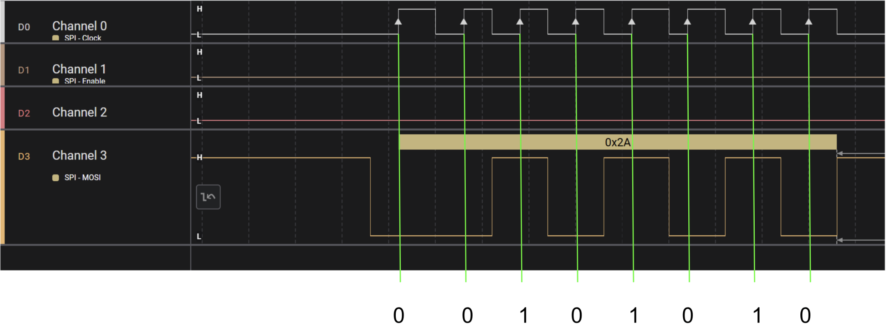
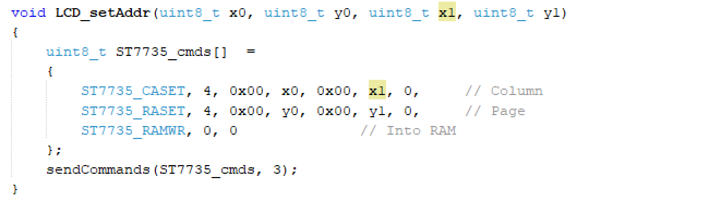
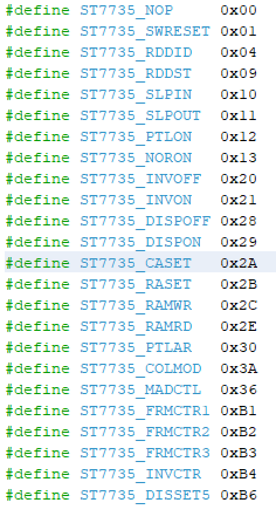

# Lab 4 Pong

**GitHub Repository URL:** https://github.com/upenn-embedded/ese5190f26-lab4-yaoe.git

| Team Member Name | Email Address                | GitHub Handle       |
|------------------|------------------         ---|---------------------|
| [Eric Yao]       | [yaoe@engineering.upenn.edu] | [eric-yaoza]        |

(I1)

unannotated screenshot: 

annotated screenshot:

The Saleae logic analyzer captured SPI communication between the ATmega and the ST7735R LCD while a white pixel was drawn at (50, 50). The 8 clock pulses transmit 00101010, which is 0x2A in hexadecimal. over MOSI. This corresponds to ST7735_CASET command in LCD_setAddr(). CS enables communication with the display, while DC is low to indicate a command rather than pixel data. CASET specifies the column address range used to position the pixel. 

Attached below are relevant code screenshots: 

